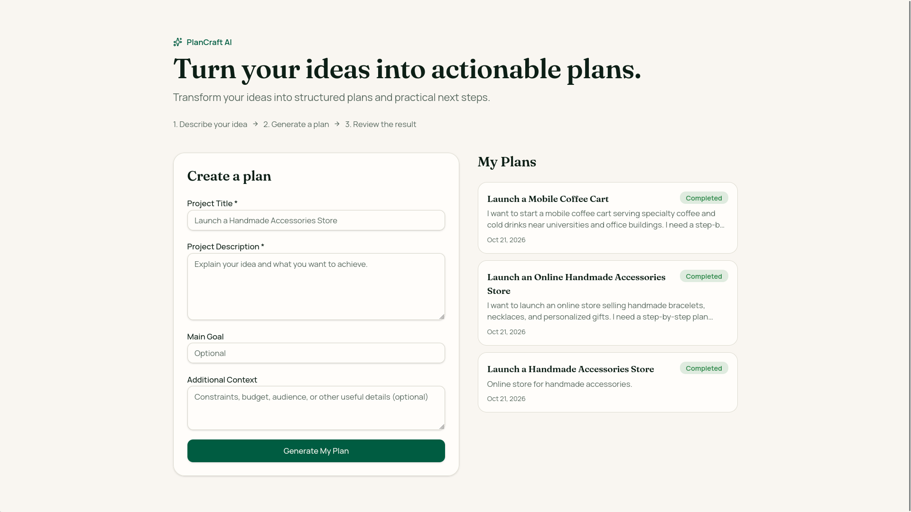
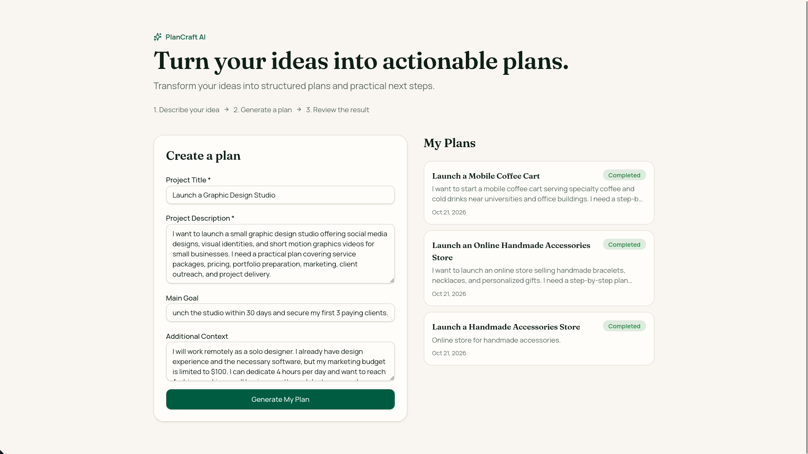
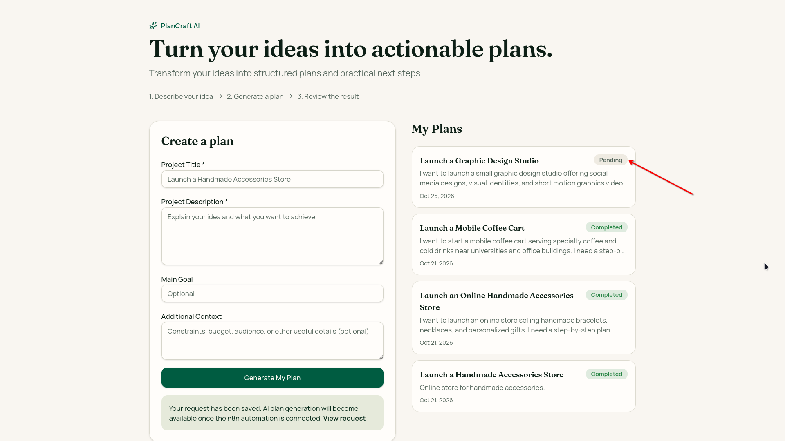
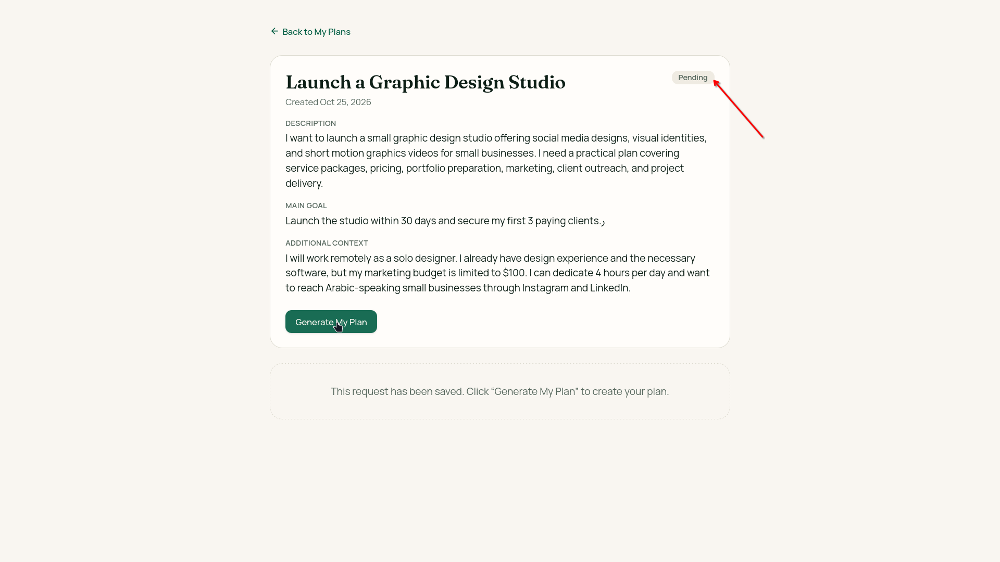
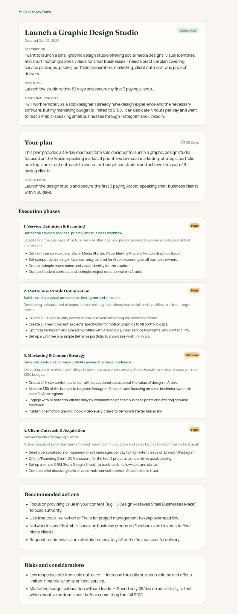
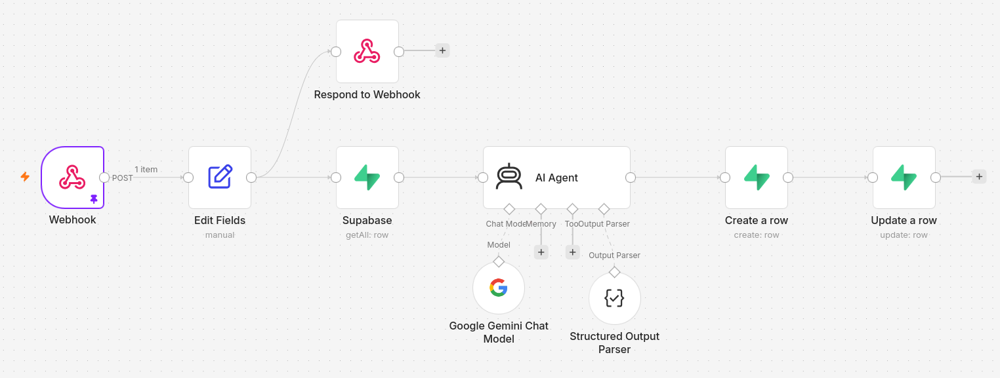
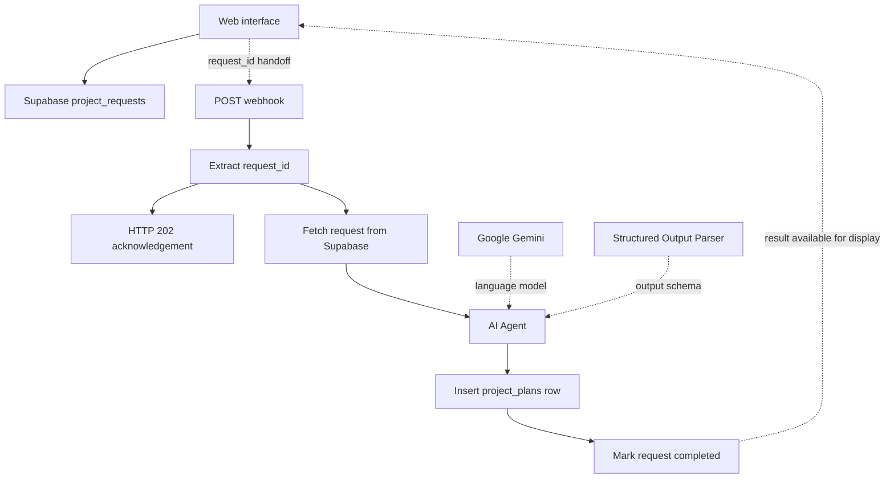

# PlanCraft AI

**Turn your ideas into actionable plans.**

PlanCraft AI transforms project ideas into structured execution plans through a web interface and an n8n automation workflow. Users describe their project, goal, and constraints; Google Gemini generates a structured plan that is stored in Supabase and displayed in the application.

**[Live Demo](https://plancraft-ai-weaam.lovable.app/)**

## Screenshots and walkthrough

The following screenshots document the application and automation supplied for this project.

### 1. Homepage and saved plans

The main page places the project brief form beside **My Plans**, where saved entries display their status and date.



### 2. Entering a project brief

The graphic design studio example includes the project description, a 30-day goal, and constraints such as budget, available time, and intended audience.



### 3. Request saved as Pending

After submission, the request appears in **My Plans** with a **Pending** badge. The message visible in this intermediate screenshot describes generation as awaiting the n8n connection; the completed state is documented below.



### 4. Pending request details

The detail page preserves the submitted description, main goal, and additional context. A **Generate My Plan** button is available in the captured pending state.



### 5. Completed plan

The later screenshot shows **Completed** status and the generated result: a summary, goal, estimated duration, four prioritized execution phases, recommendations, and risks with mitigations.

<details>
<summary>View the full completed plan screenshot</summary>



</details>

### 6. n8n automation

The workflow shows the webhook entry point, request ID extraction, acknowledgement branch, Supabase lookup, Gemini-powered agent, structured output parser, plan insertion, and status update.



## The problem

An idea alone does not tell someone what to do first, how to organize the work, or which risks to consider. PlanCraft AI turns a project brief into phases, objectives, concrete actions, priorities, and an estimated duration.

The project connects a user-facing product with an automation backend: request capture, database lookup, AI generation, structured output parsing, result storage, and request status updates.

## Features

- **Project brief submission:** collect a title, description, main goal, and additional context.
- **Request tracking:** display pending and completed requests in **My Plans**.
- **Structured plans:** present a summary, project goal, execution phases, recommendations, risks, and estimated duration.
- **Phase priorities:** categorize work as High, Medium, or Low priority.
- **Plan detail view:** show the original brief together with the generated result.
- **Database-backed automation:** retrieve requests and save generated plans through Supabase.
- **Structured AI output:** parse Gemini's response against an explicit JSON schema before database insertion.

## Demonstrated result

The supplied screenshots document a request titled **Launch a Graphic Design Studio** progressing from **Pending** to **Completed**, followed by a rendered plan.

### Example brief

| Input | Submitted example |
| --- | --- |
| Project | Launch a graphic design studio offering social media design, visual identities, and short motion graphics videos. |
| Goal | Launch within 30 days and secure the first 3 paying clients. |
| Context | Solo remote designer; $100 marketing budget; 4 hours per day; Arabic-speaking small businesses; Instagram and LinkedIn outreach. |

### Displayed plan

The completed example includes a **30 Days** duration and four execution phases:

1. **Service Definition & Branding** — High priority.
2. **Portfolio & Profile Optimization** — High priority.
3. **Marketing & Content Strategy** — Medium priority.
4. **Client Outreach & Acquisition** — High priority.

Each phase includes an objective, a description, and specific actions. The page also displays project-wide recommendations and risks paired with mitigation strategies.

This is a documented generation example, not a claim that the proposed business outcomes were achieved. The supplied evidence does not include measured latency, generation costs, or aggregate output accuracy.

## User journey

1. Enter a **Project Title** and **Project Description**.
2. Optionally provide a **Main Goal** and **Additional Context**.
3. Select **Generate My Plan**.
4. Find the saved request in **My Plans** and open its detail page.
5. Once generation completes, review the structured plan and the **Completed** status.

An intermediate screenshot also shows a generation button on the pending request's detail page. An earlier submission message says generation will become available when the n8n automation is connected; a later screenshot shows a completed result. Those screenshots represent different observed states and do not, by themselves, establish the current wiring of every live submission path.

## Architecture

The interface is published through Lovable. The supplied n8n export contains the backend workflow, with Supabase providing the request and plan tables and Gemini providing the planning model.



Solid processing connections describe the exported workflow. The interface-to-webhook handoff and result display describe the intended integration; frontend source code was not supplied to verify its exact implementation.

## n8n workflow

| Node | Responsibility |
| --- | --- |
| Webhook | Accept a POST request on the configured `PlanCraftAI` path. |
| Edit Fields | Extract `body.request_id` into `request_id`. |
| Respond to Webhook | Return an HTTP 202 JSON acknowledgement with `status: processing`. |
| Supabase | Fetch matching records from `project_requests`, filtering `id` by the request ID. |
| AI Agent | Build a project-specific planning prompt using the stored request fields. |
| Google Gemini Chat Model | Supply the language model used by the agent. |
| Structured Output Parser | Parse the response using the configured JSON schema. |
| Create a row | Insert the generated result into `project_plans`. |
| Update a row | Set the corresponding request status to `completed`. |

The acknowledgement branches from **Edit Fields**, separately from the generation path. A 202 response acknowledges receipt; it does not prove successful generation. The export does not contain a step that writes a `processing` status to the database.

The exact Gemini model identifier and the n8n application version are not explicitly specified in the supplied export.

## Request and output contracts

The webhook expects an identifier for a request already stored in the database:

```json
{
  "request_id": "<existing-project-request-id>"
}
```

The workflow then loads the title, description, goal, and additional context from Supabase. It does not use the webhook body as the full project brief.

The acknowledgement is:

```json
{
  "success": true,
  "message": "Project request received successfully",
  "status": "processing"
}
```

The generated output has six required top-level fields:

| Field | Type | Purpose |
| --- | --- | --- |
| `summary` | String | Overview of the plan. |
| `project_goal` | String | Main intended outcome. |
| `phases` | Array of objects | Ordered phases with title, objective, description, actions, and priority. |
| `recommended_actions` | Array of strings | Project-wide recommendations. |
| `risks` | Array of objects | Risk and mitigation pairs. |
| `estimated_duration` | String | Estimated overall duration. |

The schema requires the declared fields, restricts priority to `High`, `Medium`, or `Low`, and disallows additional properties at the defined object levels. The prompt asks for **3–6 phases**, but the supplied schema does not enforce that range with `minItems` and `maxItems`. Structural parsing also does not guarantee that a plan is factually correct or feasible.

## Data model used by the workflow

| Table | Referenced fields |
| --- | --- |
| `project_requests` | `id`, `title`, `description`, `goal`, `additional_context`, `status` |
| `project_plans` | `request_id`, `summary`, `project_goal`, `phases`, `recommended_actions`, `risks`, `estimated_duration` |

This describes fields referenced by the automation, not a complete database schema. SQL definitions, indexes, uniqueness constraints, access policies, and frontend timestamp fields were not included in the supplied export.

## Configuration guide

To recreate the integration:

1. Prepare compatible Supabase request and plan tables, with appropriate JSON-capable fields for arrays and objects.
2. Import the n8n workflow into a compatible n8n installation.
3. Connect your own Supabase and Gemini credentials; select the intended Gemini model explicitly.
4. Replace environment-specific Supabase project settings with your own values.
5. Configure the interface to save a project request and send its ID to the deployed webhook.
6. Configure the interface to retrieve the saved result and updated status.
7. Test the complete request-to-result journey before sharing the application with users.

The supplied materials include an n8n export and screenshots, but not the frontend source or complete database setup. No unverified local installation commands are provided here. Credentials, project-specific configuration, pinned execution data, and private endpoints must be reviewed before publishing a workflow export.

## Validation and future improvements

**Documented:** form input, a saved pending request, a completed request, and a rendered plan for the same graphic design studio example. The JSON export supports the described backend node configuration. No live generation was executed while preparing this README.

Recommended next steps:

- Validate request IDs and handle missing records before calling the model.
- Add explicit failure handling and a user-visible failed state.
- Prevent duplicate plan insertion when the same request is submitted repeatedly.
- Review webhook authentication and database access policies; the exported webhook parameters do not declare authentication.
- Enforce the phase count in the output schema.
- Verify acknowledgement timing and repeated submissions under real deployment conditions.
- Record generation latency, cost, and output quality across multiple test cases.

## بالعربية

**PlanCraft AI** يحوّل وصف فكرة المشروع إلى خطة تنفيذ منظمة باستخدام واجهة ويب وn8n وGoogle Gemini وSupabase.

يُحفظ الطلب أولًا، ثم يستقبل مسار الأتمتة معرّفه ويسترجع تفاصيله من قاعدة البيانات. يولّد Gemini خطة بصيغة منظمة، ويمرّرها المسار إلى Structured Output Parser، ثم يحفظها ويحدّث حالة الطلب إلى completed.

تتضمن النتيجة ملخصًا، وهدفًا، ومراحل تنفيذ بأولويات وإجراءات محددة، وتوصيات، ومخاطر مع طرق التعامل معها، ومدة تقديرية. توثّق الصور المرفقة مثال إطلاق استوديو تصميم وانتقاله من Pending إلى Completed.

[تجربة الموقع](https://plancraft-ai-weaam.lovable.app/)
